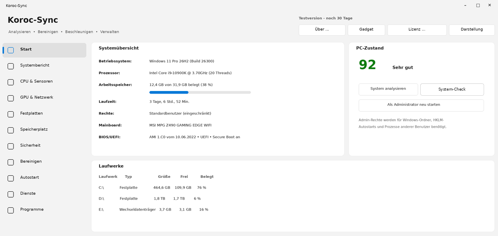
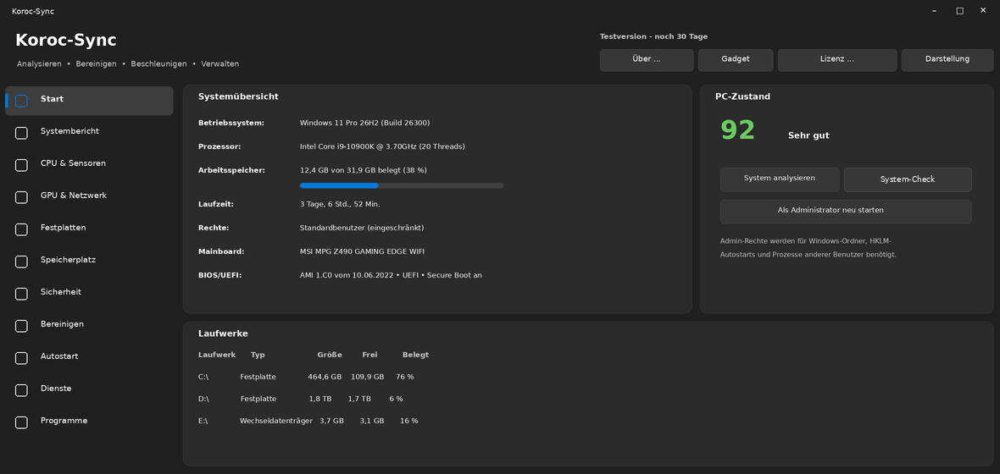

# Koroc-Sync

**Systempflege für Windows 10 und 11 – analysieren, bereinigen, beschleunigen, verwalten.**
`BETA` · Copyright © 2026 Christoph Olf

Koroc-Sync fasst die wichtigsten Werkzeuge zur PC-Pflege in einem übersichtlichen Programm im Windows-11-Design zusammen – mit hellem und dunklem Modus, in Deutsch und Englisch. Jede verändernde Aktion wird vorher angekündigt und lässt sich – wo möglich – rückgängig machen.

| Heller Modus | Dunkler Modus |
|---|---|
|  |  |

Schematische Darstellung der Startseite.

## Download

➡ **[Neueste Version herunterladen](https://github.com/ChristophO250/Koroc-Sync/releases)** – unter „Assets“ die Datei `KorocSync-Setup-….exe` laden und starten.

Koroc-Sync prüft auf der Seite **Updates** über „Auf neue Koroc-Sync-Version prüfen“ selbst, ob hier eine neuere Version erschienen ist.

## Funktionen

- **Analyse:** PC-Zustand mit Prozentanzeige, Systembericht, CPU/Temperaturen/Lüfter, Grafikkarte, Netzwerk, Festplatten (SMART), BIOS/UEFI, Akku, USB-Anschlüsse, Treiber
- **Bereinigen:** Temporäre Dateien, Update-Cache, Browser-Daten – immer mit Testlauf, Vorschau, Sicherheitsabfrage und Wiederherstellungspunkt
- **Speicherplatz:** Ordnergrößen, große und doppelte Dateien
- **Leistung:** Leistungs-Check mit Empfehlungen (rückgängig machbar) und Live-Optimierung
- **Registry:** verwaiste Einträge finden – mit Sicherung vor jeder Änderung
- **Wiederherstellen:** gelöschte Dateien aus dem Papierkorb zurückholen
- **Verwalten:** Autostart, Dienste, Programme, Programm-Updates (winget), Prozesse mit CPU-/RAM-Anteil, Energiepläne
- **Komfort:** Symbol im Infobereich mit Warnungen, Desktop-Gadget, Rechtsklick-Menüs in allen Listen

Ausführlich: [Kurzbeschreibung (PDF)](docs/Koroc-Sync_Kurzbeschreibung.pdf)

## Testversion, Lizenz und Beta

- **14 Tage** kostenlos mit allen Funktionen testen; danach ohne Lizenz nur noch Systembericht.
- Lizenzen (Einzelplatz, Mehrplatz, Firma) gelten **1 Jahr** ab Ausstellung und werden direkt im Programm über „Lizenz erwerben“ bestellt.
- **Beta-Tester** erhalten eine kostenlose Beta-Lizenz für 30 Tage, die im Programm über „Verlängerung anfragen“ verlängert werden kann.
- Lizenzbedingungen: [LIZENZ.txt](LIZENZ.txt) (verbindlich) · [LICENSE-EN.txt](LICENSE-EN.txt)

> **Beta-Hinweis:** Diese Version kann noch Fehler enthalten. Bitte vor dem Bereinigen wichtige Daten sichern. Fehler bitte über „Fehler melden“ im Programm oder als [Issue](https://github.com/ChristophO250/Koroc-Sync/issues) melden.

## Systemvoraussetzungen

Windows 10 oder Windows 11 · für einige Funktionen (Dienste, Wiederherstellungspunkt, GPU-Planung) Administratorrechte · Temperaturen und Lüfter optional über LibreHardwareMonitor.

## Kontakt

E-Mail: **korocsync@gmail.com**

Koroc-Sync ist urheberrechtlich geschützte Software. Der Quellcode ist nicht öffentlich.
