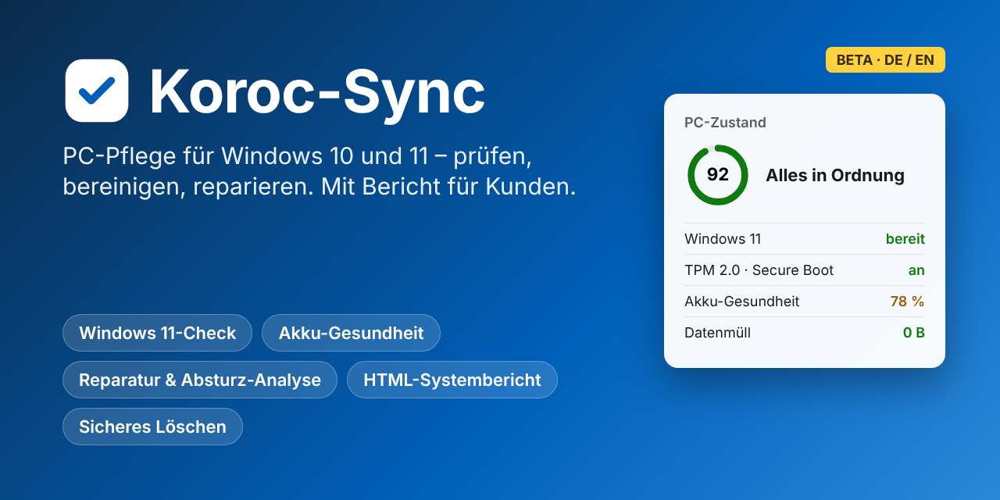

# 🛠️ Koroc-Sync

**PC-Pflege und PC-Prüfung für Windows 10 und 11 – aus der Praxis, für die Praxis.**

### [⬇️ Neueste Version herunterladen](https://github.com/ChristophO250/Koroc-Sync/releases/latest)

## 👋 Worum es geht

Koroc-Sync ist aus der Praxis entstanden: Wer Gebäudetechnik und KNX-Anlagen betreut, sitzt früher oder später fast immer auch vor einem Windows-PC – dem Rechner mit der ETS oder dem Büro-PC, der „seit dem letzten Update so langsam ist“.

Statt für jede Kleinigkeit ein anderes Werkzeug zu starten, macht Koroc-Sync alles in einem Programm: prüfen, messen, aufräumen – und am Ende einen sauberen Bericht für den Kunden schreiben.

---

## 🔍 Prüfen und messen

| | Funktion | Was sie zeigt |
|:---:|---|---|
| 📊 | **Dashboard** | Prozessor, Speicher, Laufwerke, Netzwerk, Sicherheit und Updates auf einen Blick – grün, orange oder rot |
| 🪟 | **Windows 11-Check** | TPM 2.0, Secure Boot, UEFI, Prozessor, RAM – und was im BIOS umzustellen ist |
| 💾 | **Festplatten & Laufwerk-Tempo** | SMART-Werte und Geschwindigkeit von SSD, Festplatte und USB-Stick, mit Hinweisen (z. B. falscher M.2-Steckplatz) |
| 🧠 | **RAM-Test** | Eingebaute Module, Schnelltest unter Windows, Windows-Speicherdiagnose beim Neustart |
| 🌀 | **Lüftertest** | 60 Sekunden Volllast: Drehen die Lüfter hoch? Wie warm wird die CPU? |
| 🔋 | **Akku-Gesundheit** | Kapazität im Vergleich zum Neuzustand, Ladezyklen, Verlauf über die Monate |
| ⌨️ | **Hardware-Check** | Bildschirm (Pixelfehler), Tastatur, Maus (prellende Tasten) und Lautsprecher |
| 💥 | **Absturz-Analyse** | Bluescreens und abgestürzte Programme mit Erklärung der Fehlercodes |

## 🌐 Netzwerk

| | Funktion | Was sie zeigt |
|:---:|---|---|
| 🚀 | **Speedtest** | Download, Upload und Ping – im Vergleich zum gebuchten Tarif |
| 📈 | **Ping-Langzeittest** | Aussetzer über Stunden: liegt es am eigenen Netz oder am Anbieter? Mit CSV-Protokoll für den Anbieter |
| 🔎 | **Netzwerk-Scanner** | Alle Geräte im Netz, offene Ports, Ping per Klick, Übersicht aller Weboberflächen – unsichere Dienste ⚠️ gelb markiert |
| 📶 | **WLAN in der Nähe** | Netze mit Signal, Kanal und Verschlüsselung, Tipp für den besten Kanal |
| 🏠 | **KNX-IP prüfen** | Schnittstellen und Router finden, Tunnel testen, freie Tunnel zählen, Multicast-Routing mitlesen – ohne etwas auf den Bus zu senden |

## 🧹 Aufräumen und reparieren

| | Funktion | Was sie macht |
|:---:|---|---|
| 🗑️ | **Bereinigen** | Temporäre Dateien, Update-Reste, Browser-Daten – immer mit Vorschau und Wiederherstellungspunkt |
| 🩺 | **Windows reparieren** | SFC, DISM, Datenträgerprüfung, Netzwerk zurücksetzen per Knopfdruck |
| 📅 | **Geplante Wartung** | Räumt automatisch im Hintergrund auf |
| ⚡ | **Leistung** | Autostart, Dienste, Prozesse, Leistungs-Check mit Empfehlungen |
| 🔒 | **Sicheres Löschen** | Dateien unwiederbringlich überschreiben, freien Speicher bereinigen |
| 🧩 | **Programme & Treiber** | Programm-Updates (winget), Treiber, Registry mit Sicherung |

## 🧾 Berichte

| | Bericht | Inhalt |
|:---:|---|---|
| 📄 | **Systembericht** | Alles Wichtige als Text oder als HTML-Datei mit Grafiken – druckbar als PDF |
| 🏷️ | **Kundenbericht** | Mit Firmenlogo, Auftragsnummer, erledigten Arbeiten und Unterschriftsfeldern. Koroc-Sync schreibt automatisch mit, was in der Sitzung gemacht wurde. |

---

## 🎚️ Ausgaben

Nach der Installation laufen **14 Tage alle Funktionen**. Danach bleibt Koroc-Sync als **kostenlose Lite-Version** nutzbar.

| | 🆓 Lite | ⭐ Standard | 💼 Professional |
|---|:---:|:---:|:---:|
| Dashboard, Systembericht, Windows 11-Check, Speedtest, Hardware-Check, Bereinigen | ✅ | ✅ | ✅ |
| Akku, RAM-Test, Lüftertest, Laufwerk-Tempo, Ping-Langzeittest, Programme, Dienste, Updates | | ✅ | ✅ |
| Netzwerk-Scanner, KNX-IP, Reparatur, Absturz-Analyse, Registry, Treiber, geplante Wartung, Kundenbericht | | | ✅ |

Lizenzen gelten ein Jahr und werden direkt im Programm bestellt. Während der Beta gibt es kostenlose Beta-Lizenzen. Bedingungen: [LIZENZ.txt](LIZENZ.txt) · [LICENSE-EN.txt](LICENSE-EN.txt)

---

## 💿 Installation

| Schritt | |
|:---:|---|
| 1️⃣ | Setup von der [Release-Seite](https://github.com/ChristophO250/Koroc-Sync/releases/latest) laden (unter „Assets“: `KorocSync-Setup-….exe`) |
| 2️⃣ | Starten. Meldet Windows „Der Computer wurde durch Windows geschützt“: **Weitere Informationen → Trotzdem ausführen**. Das Programm ist neu und hat noch kein gekauftes Signatur-Zertifikat. |
| 3️⃣ | Fertig. Updates findet Koroc-Sync selbst unter **Updates → Auf neue Koroc-Sync-Version prüfen**. |

**Voraussetzungen:** Windows 10 oder 11 · für einige Funktionen Administratorrechte · Temperaturen und Lüfter über [LibreHardwareMonitor](https://github.com/LibreHardwareMonitor/LibreHardwareMonitor) (optional)

---

## 🎁 Fehler gefunden? Es gibt eine Belohnung

| Meldung | Dankeschön |
|---|---|
| 🐞 Bestätigter Fehler | Lizenz **+3 Monate** |
| 💥 Schwerer Fehler oder 💡 Idee, die umgesetzt wird | **1 Jahr Professional** |
| 🙌 Auf Wunsch | Nennung im [CHANGELOG](CHANGELOG.md) |

Am einfachsten im Programm unter **Systembericht → „Fehler melden“** – Version, Windows und PC-ID sind dann gleich dabei. Oder als [Issue](https://github.com/ChristophO250/Koroc-Sync/issues).

Belohnt wird die erste Meldung eines Fehlers, der sich nachstellen lässt. Keine Barauszahlung, kein Rechtsanspruch.

> ⚠️ **Beta:** Vor dem Aufräumen bitte wichtige Daten sichern.

⭐ **Gefällt dir Koroc-Sync?** Ein Stern oben rechts hilft, dass mehr Leute es finden.

---

## 🇬🇧 English

Koroc-Sync is a maintenance and diagnostics tool for Windows 10 and 11, made for technicians who look after PCs and building automation (KNX).

| | |
|:---:|---|
| 🔍 | Hardware checks: disks & SSD speed, RAM, fans under load, battery health, Windows 11 readiness, monitor/keyboard/mouse/speaker test |
| 🌐 | Network: speed test, long-term ping, network scanner with ports, **KNX IP** tunnelling and routing test |
| 🧹 | Clean-up and repair: temp files, SFC/DISM, crash analysis, scheduled maintenance |
| 🧾 | Reports: HTML report with charts, customer report with your own logo |

Free **Lite** edition after a 14-day full trial · German and English · [⬇️ Download](https://github.com/ChristophO250/Koroc-Sync/releases/latest)

---

📬 korocsync@gmail.com · © 2026 Koroc-Sync · Der Quellcode ist nicht öffentlich.
