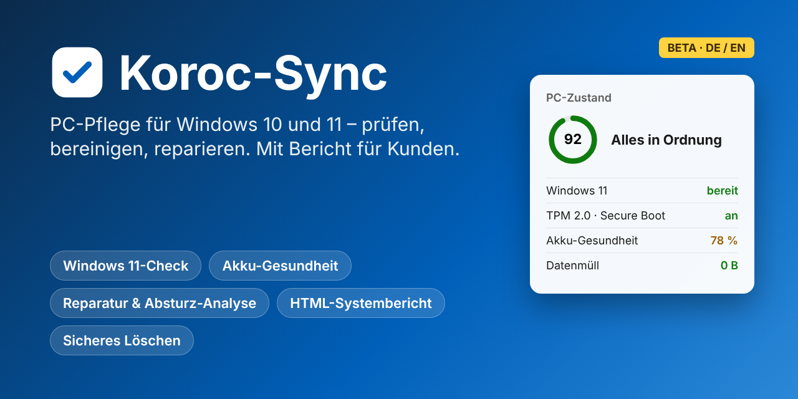

# Koroc-Sync

**PC-Pflege für Windows 10 und 11 – prüfen, bereinigen, reparieren, dokumentieren.**

[**⬇ Download**](https://github.com/ChristophO250/Koroc-Sync/releases/latest) · [Funktionen](#funktionen) · [Ausgaben](#ausgaben) · [Für PC-Techniker](#für-pc-techniker) · [Belohnung für Fehler](#mitmachen--mit-belohnung-) · [English](#english)

## Warum Koroc-Sync?

- **Ein Programm statt zehn:** Systeminfo, Bereinigung, Reparatur, Treiber, Autostart und Berichte in einer Oberfläche im Windows-11-Design – hell und dunkel.
- **Klare Antworten statt Fachbegriffe:** Ein PC-Zustand in Prozent, farbige Kacheln (grün, orange, rot) und zu jedem Problem ein Satz, was zu tun ist.
- **Sicher:** Jede verändernde Aktion wird vorher angezeigt. Vor dem Bereinigen gibt es einen Testlauf und einen Wiederherstellungspunkt, vor Registry-Änderungen eine Sicherung.
- **Ohne Ballast:** Keine Werbung und keine Zusatzprogramme im Setup.

## Neu in dieser Version

| | Funktion | Kurz erklärt |
|---|---|---|
| 🪟 | **Windows 11-Check** | Prüft TPM 2.0, Secure Boot, UEFI, Prozessor, RAM und Laufwerk und sagt, was im BIOS umzustellen ist |
| 🔋 | **Akku-Gesundheit** | Kapazität im Vergleich zum Neuzustand, Ladezyklen und Verlauf über die Monate |
| 📊 | **HTML-Systembericht mit Grafiken** | Eine Datei mit Zustandsring, Kacheln, Laufwerksbalken und Verlaufskurven, druckbar als PDF |
| 🧾 | **Kundenbericht** | Wartungsbericht mit eigenem Logo, Auftragsdaten, erledigten Arbeiten und Unterschriftsfeldern |
| 🛠 | **Windows reparieren** | SFC, DISM, Komponenten-Bereinigung, Datenträgerprüfung und Netzwerk-Reset per Knopfdruck |
| 💥 | **Absturz-Analyse** | Bluescreens, unerwartete Neustarts und abstürzende Programme, mit Erklärung der Stop-Codes |
| 📅 | **Geplante Wartung** | Automatische Bereinigung und Prüfung nach Zeitplan |
| 🔒 | **Sicheres Löschen** | Dateien unwiederbringlich überschreiben und freien Speicher bereinigen |
| 📶 | **WLAN in der Nähe** | Netze mit Signal, Kanal und Verschlüsselung, dazu ein Tipp für den besten Kanal |

## Funktionen

| Bereich | Enthalten |
|---|---|
| **Übersicht** | Startseite mit PC-Zustand, Dashboard mit Live-Kacheln, Systembericht (Text und HTML) |
| **Hardware** | CPU mit Temperaturen, Grafik und Netzwerk, WLAN-Scan, Festplatten mit SMART, Monitore (EDID), USB, Energie, Akku |
| **Aufräumen** | Temporäre Dateien, Update-Cache, Browser-Daten, Speicherplatz-Analyse, Registry, Papierkorb-Wiederherstellung, sicheres Löschen, Netzwerk-Bereinigung |
| **Wartung und Reparatur** | Geplante Wartung, Windows-Reparatur, Absturz-Analyse |
| **Leistung** | Leistungs-Check mit Empfehlungen (rückgängig machbar), Autostart, Dienste, Prozesse |
| **Software und Sicherheit** | Windows 11-Check, Programme, Programm-Updates (winget), Treiber, Virenschutz-Status |
| **Komfort** | Symbol im Infobereich mit Warnungen, Desktop-Gadget, Start mit Windows, Rechtsklick-Menüs in allen Listen |

Ausführlich: [Kurzbeschreibung (PDF)](docs/Koroc-Sync_Kurzbeschreibung.pdf)

## Ausgaben

| | Lite | Standard | Professional |
|---|:---:|:---:|:---:|
| PC-Zustand, Dashboard, Systembericht (Text und HTML) | ✔ | ✔ | ✔ |
| Hardware-Infos, Windows 11-Check, Bereinigung, Autostart, Sicherheit | ✔ | ✔ | ✔ |
| Akku-Gesundheit, Energie, Speicherplatz, Programme, Updates, Dienste, Prozesse, Leistungs-Check, Netzwerk-Bereinigung | | ✔ | ✔ |
| Registry, Treiber, Datei-Wiederherstellung, sicheres Löschen | | | ✔ |
| Geplante Wartung, Windows-Reparatur, Absturz-Analyse | | | ✔ |
| Kundenbericht mit eigenem Logo | | | ✔ |

- **14 Tage kostenlos** mit allen Funktionen (Professional) testen; danach läuft das Programm als kostenlose **Lite-Ausgabe** weiter.
- Lizenzen gelten **1 Jahr** und werden direkt im Programm über „Lizenz erwerben“ bestellt.
- **Beta-Tester** erhalten eine kostenlose Beta-Lizenz. Lizenzbedingungen: [LIZENZ.txt](LIZENZ.txt) · [LICENSE-EN.txt](LICENSE-EN.txt)

## Für PC-Techniker

Koroc-Sync ist auch für Elektro- und IT-Betriebe gedacht, die Kunden-PCs warten:

1. **Vorher prüfen:** Dashboard und Windows 11-Check zeigen in einer Minute, wo es hakt.
2. **Arbeiten erledigen:** Bereinigen, reparieren, Treiber und Autostart aufräumen. Jede Aktion landet automatisch im Arbeitsprotokoll.
3. **Bericht übergeben:** Der Kundenbericht mit Ihrem Logo enthält Auftrag, erledigte Arbeiten, PC-Zustand mit Grafiken und Felder für Unterschriften. Sie können ihn ausdrucken oder als PDF schicken.

## Download und Installation

1. [**Neueste Version herunterladen**](https://github.com/ChristophO250/Koroc-Sync/releases/latest) und unter „Assets“ die Datei `KorocSync-Setup-….exe` laden.
2. Setup starten. Meldet Windows SmartScreen „Der Computer wurde durch Windows geschützt“, auf **Weitere Informationen → Trotzdem ausführen** klicken. Das kommt bei neuen Programmen ohne gekauftes Code-Signatur-Zertifikat vor.
3. Koroc-Sync prüft über **Updates → Auf neue Koroc-Sync-Version prüfen** selbst, ob es hier eine neuere Version gibt.

**Voraussetzungen:** Windows 10 oder 11. Für einige Funktionen (Dienste, Reparatur, Wiederherstellungspunkt) sind Administratorrechte nötig. Temperaturen und Lüfter liest das Programm optional über LibreHardwareMonitor.

## Mitmachen – mit Belohnung 🎁

Jeder gefundene Fehler macht Koroc-Sync besser. Als Dankeschön gibt es:

| Meldung | Belohnung |
|---|---|
| **Bestätigter Fehler** | Lizenz **+3 Monate** (ohne Lizenz: 3 Monate Professional) |
| **Schwerer Fehler** (Absturz, falsche Löschung) **oder eine Idee, die umgesetzt wird** | **1 Jahr Professional** |
| Auf Wunsch | Nennung als Helfer im [CHANGELOG](CHANGELOG.md) |

**So geht's:** Im Programm auf der Seite **Systembericht → „Fehler melden“** klicken. Die E-Mail mit Version, Windows-Version und PC-ID wird automatisch vorbereitet, der Systembericht liegt in der Zwischenablage (Strg+V). Alternativ ein [Issue](https://github.com/ChristophO250/Koroc-Sync/issues) anlegen und die PC-ID per E-Mail nachreichen.

Bedingungen: Belohnt wird die erste Meldung eines Fehlers, der sich nachstellen lässt. Die Entscheidung trifft der Entwickler. Keine Barauszahlung, kein Rechtsanspruch.

**Gefällt dir Koroc-Sync?** Ein ⭐ oben rechts hilft, dass mehr Leute das Programm finden.

> **Beta-Hinweis:** Diese Version kann noch Fehler enthalten. Bitte vor dem Bereinigen wichtige Daten sichern.

---

## English

**Koroc-Sync** is a maintenance tool for Windows 10 and 11 with a Windows 11 style interface (light and dark mode, German and English).

- **Check:** PC health score, live dashboard, **Windows 11 readiness check** (TPM 2.0, Secure Boot, UEFI, CPU) and **battery health** with capacity history
- **Clean:** temporary files, update cache, browser data, registry, secure delete, network cleanup – always with preview and restore point
- **Repair:** SFC, DISM, disk check, network reset, **crash analysis** (blue screens explained) and scheduled maintenance
- **Report:** system report as a single **HTML file with charts**; the Professional edition adds a **customer report** with your own logo for IT service providers

Editions: **Lite** (free), **Standard**, **Professional**, with a 14-day full trial. **Bug bounty:** every confirmed bug reported via "Report a bug" earns a 3-month licence extension, serious bugs or implemented ideas 1 year Professional. [Download the latest release](https://github.com/ChristophO250/Koroc-Sync/releases/latest).

---

Copyright © 2026 Christoph Olf · Kontakt: korocsync@gmail.com · Koroc-Sync ist urheberrechtlich geschützte Software, der Quellcode ist nicht öffentlich.
